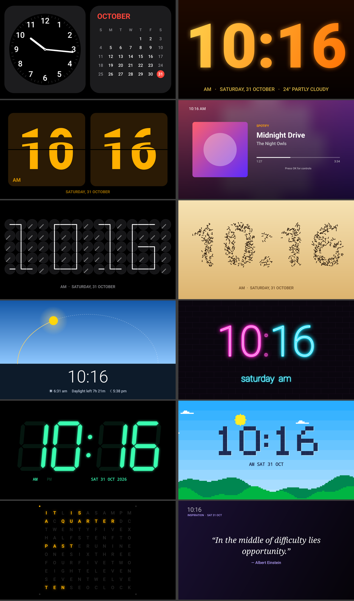

# StandBy TV



An iOS-StandBy-style clock and widget screen for **Android TV 8.0+**. You can open it as an app or set it as the TV's screensaver.

**[⬇ Download the APK](apk/StandBy-TV.apk)** · **[Set it up on your TV](#setting-it-up-on-your-tv)** · **[Troubleshooting](#troubleshooting)**

**Package:** `com.yash.standbytv` · **minSdk:** 26 (Android 8.0) · **APK size:** about 480 KB · **No ads, no tracking**. Libraries: ZXing (QR codes) and Google Play services sign-in (for Google Photos)

---

## Screens

Use **◀ ▶** to move between screens and **▲ ▼** to change a screen's style. Each screen remembers its style.

| Screen | Styles | Notes |
|---|---|---|
| **Duo** | Analog + Calendar, Digital + Calendar, Analog + Weather, Digital + Weather, Weather + Calendar | The classic StandBy look: two rounded widgets side by side |
| **Big Clock** | 18 colour themes, including Diwali, Holi, Aurora, Peacock, Himalaya and Monsoon | Gradient digits that fill the screen. Some themes glow |
| **Flip Clock** | Graphite, Paper, Amber, Midnight Blue | Each flap animates in two stages |
| **Analog** | StandBy, Classic White, Minimal, Ticks | Shows the date and weather next to the dial |
| **Weather** | Sky, Black | The background colour follows the current conditions |
| **Now Playing** | Blurred Art, Card, Minimal | Spotify, YouTube Music, YouTube or any other player on the TV. **OK** shows ⏮ ⏯ ⏭ |
| **Photos** | Small clock, Large clock, Photos only | Slideshow from **Google Photos albums**, TV storage or a USB drive |
| **Clock of Clocks** | Dark, Light, Blueprint, Copper | 60 small analog clocks whose hands draw the time. They spin into place every minute |
| **Ants Clock** | Sunny, Night, Rainy, Snowy, AMOLED | 760 ants walk into the shape of the digits |
| **Solar Watch** | Sun Arc, 24-hour Dial | Shows where the sun is today, using real sunrise and sunset times |
| **Neon** | Hot Pink, Ice Cyan, Lime, Sunset Orange, Pink & Blue | Neon-sign glow on a brick wall, with an occasional flicker |
| **LED Clock** | Red LED, Green VFD, Ice Blue, Amber, White | Seven-segment display with faint unlit segments |
| **Pixel Art** | Landscape, Game Boy, Arcade | 8-bit digits over a landscape that changes from day to night |
| **Word Clock** | White, Amber, Cyan, Mint, Rose | Spells the time, e.g. "IT IS TWENTY FIVE PAST NINE" |
| **Matrix** | Green, Cyan, Red, Purple, Gold | Falling green code behind the time |
| **World Clock** | Asia & Europe, Americas, Pacific | Four cities, each showing its offset from your local time |
| **Quotes** | Inspiration, Stoic, Calm, Affirmations | A new quote every 45 seconds, with a soft fade |

**OK** opens Settings. On Now Playing, OK shows the music controls instead; **hold OK** opens Settings from any screen. **BACK** exits.

## Settings
- 12/24-hour time and an optional seconds display
- °C or °F. Location is either **automatic** (worked out from your internet connection, since TVs have no GPS) or a **city you type in**
- **Night mode** (off, scheduled, or always on), shown as a red tint (like iOS) or dimmed. You pick the start and end hours
- **Burn-in protection**: the picture shifts by a few pixels every minute
- **Auto-rotate screens** every 1, 5, 15, 30 or 60 minutes
- **Open when TV starts** (works on Android TV 8/9; newer versions may block it)
- **Screensaver shows**: the last screen you used, or one fixed screen
- Show or hide each screen

## Now Playing (Spotify / YouTube Music)
This screen shows whatever is playing **on the TV**, from any app that uses Android's standard media controls: Spotify, YouTube Music, YouTube, Prime Video and so on. It also works when you cast to the TV.

Android needs you to allow this once. The [setup script](#quick-setup-recommended) does it for you. To do it by hand, see [step 4 of manual setup](#4-allow-the-now-playing-music-screen).
On the Now Playing screen, press **OK** to show the controls. Use ◀ ▶ to pick ⏮ ⏯ ⏭, OK to press it, and BACK to hide them. Media buttons on the remote also work.

## Google Photos slideshow
Since March 2025, Google no longer lets any app browse your library or list your albums. The only official option is the **Google Photos Picker**, so it works like this:

1. Once only: [register the app with Google](#one-time-google-cloud-setup-about-10-minutes-free). Then Settings → **Google Photos albums** → **Sign in with Google**, pick the TV's Google account and tap **Allow**.
2. **＋ New album**: name it, for example "Goa trip". Scan the QR code. Google Photos opens on your phone. Pick photos, or **search an album's name, select all**, and tap **Done**.
3. The TV downloads them once (up to 600 per pick, at TV resolution). They then play offline in the **Photos** screen.
4. Each album can be **shown or hidden**, **renamed**, **deleted**, or have **more photos added**. Settings → **Slideshow source** chooses between Google Photos, TV storage, or both.

StandBy TV can only ever see the photos you pick.

### One-time Google Cloud setup (about 10 minutes, free)
StandBy TV signs in with the **Google account already on the TV** (the one the Play Store uses). Google only lets an app do that once the app is registered in a Google Cloud project. The app itself has no ID or secret to type in.

> Google's "enter a code on your phone" TV sign-in can't be used: it doesn't support Google Photos.

1. Go to <https://console.cloud.google.com>, then project picker → **New project**. Use a **unique Project ID** (click *Edit*, e.g. `standby-tv-yourname`), then **Create**. If the page just refreshes, open the project picker; the project is often already there.
2. **APIs & Services → Library**: find **Photos Picker API** and **Enable** it.
3. **Google Auth Platform → Get started**:
   - App name: `StandBy TV`, and your email as support and contact email
   - Audience: **External**
   - Agree and **Create**
4. **Audience → Test users → Add users**: add every Gmail that will sign in on a TV.
   *To skip the test-user list and the weekly re-sign-in, click **Publish app** instead. Users then see "Google hasn't verified this app" once; they choose **Advanced → Go to StandBy TV**.*
5. **Data access → Add or remove scopes**: add `https://www.googleapis.com/auth/photospicker.mediaitems.readonly` under *Manually add scopes*, then **Update → Save**.
6. **Clients → Create client** → Application type **Android**:
   - Package name: `com.yash.standbytv`
   - SHA-1 certificate fingerprint: the SHA-1 of the key that signed your APK. For the APK in this repo it's
     `AA:89:99:11:6B:90:2B:9F:2D:7A:BC:AC:16:F3:1A:B6:50:95:31:80`
   - **Create**. Nothing needs copying back into the app.
7. On the TV: StandBy TV → Settings → **Google Photos albums** → **Sign in with Google**. Pick your account, tap **Allow**, and then add albums.

**Using the APK from this repo?** The Android client in step 6 belongs to whoever owns the Google Cloud project. The repo owner's project covers the published APK for accounts added as test users, or for everyone once that project is published. If you'd rather use your own project, do all the steps above with the same SHA-1.

**Building the app yourself with your own key?** Get your key's SHA-1 with
`keytool -list -v -keystore your-key.jks -alias your-alias`. For the debug key, the alias is `androiddebugkey`, the password is `android`, and the keystore is `~/.android/debug.keystore`. Use that SHA-1 in step 6.

## Setting it up on your TV

You need the TV, and a Windows, Mac or Linux computer on the **same Wi-Fi**.

### 1. Turn on developer mode on the TV (one time)
1. Open the TV's **Settings → Device Preferences → About**. On Google TV it's **Settings → System → About**.
2. Select **Build** (or **Android TV OS build**) **7 times**, until it says you're a developer.
3. Go back to **Device Preferences → Developer options** and turn on **USB debugging**. If you also see **Network debugging** or **ADB debugging over network**, turn that on too.
4. Find the TV's IP address under **Settings → Network & Internet → (your Wi-Fi)**, for example `192.168.1.9`.

### 2. Install ADB on your computer (one time)
| Computer | Command |
|---|---|
| Windows | `winget install Google.PlatformTools`, then open a **new** PowerShell window |
| macOS | `brew install android-platform-tools` |
| Ubuntu / Debian | `sudo apt install adb` |

### Quick setup (recommended)
Download or clone this repo, then run **one** command from its folder, using your TV's IP:

**Windows (PowerShell):**
```powershell
powershell -ExecutionPolicy Bypass -File tools\setup-tv.ps1 -TvIp 192.168.1.9
```
**macOS / Linux:**
```bash
./tools/setup-tv.sh 192.168.1.9
```
The first time, the TV shows **"Allow USB debugging?"**. Tick **Always allow from this computer**, choose **OK**, and run the command again.

The script:
1. installs the app (the APK in [`apk/`](apk/)),
2. allows the **Now Playing** music screen,
3. sets StandBy TV as the **screensaver**, starting after **5 minutes** idle,
4. makes the TV wait **4 hours** before switching itself off, so it doesn't just sleep at 5 minutes,
5. checks every setting and starts the screensaver once as a test.

Options:
- Windows: `-IdleMinutes 6`, `-SleepHours 0` (never switch off), `-SkipInstall`
- Mac/Linux: `./tools/setup-tv.sh <ip> <idle-minutes> <sleep-hours>`

It's safe to run again at any time, for example after updating the app. **After an uninstall/reinstall, always re-run it**, because Android removes the music access when an app is uninstalled.

### Manual setup (same steps, one at a time)
```bash
adb connect 192.168.1.9
```
Accept the prompt on the TV, then:

#### 3. Install
```bash
adb install -r StandBy-TV.apk
```
Installing with ADB avoids the Play Protect block described under Troubleshooting.

#### 4. Allow the Now Playing music screen
```bash
adb shell cmd notification allow_listener com.yash.standbytv/com.yash.standbytv.MediaListener
adb shell settings get secure enabled_notification_listeners
```
If the second command doesn't list `com.yash.standbytv/...MediaListener` (some TVs, Xiaomi included, ignore the first command), add it yourself. Put whatever the TV already lists **first**, add `:` and our entry, so nothing else breaks:
```bash
adb shell settings put secure enabled_notification_listeners "<what it listed>:com.yash.standbytv/com.yash.standbytv.MediaListener"
```
If it listed `null`, use just `com.yash.standbytv/com.yash.standbytv.MediaListener`. Then restart the app with `adb shell am force-stop com.yash.standbytv`.

#### 5. Make it the screensaver
```bash
adb shell settings put secure screensaver_enabled 1
adb shell settings put secure screensaver_activate_on_sleep 1
adb shell settings put secure screensaver_components com.yash.standbytv/.StandbyDream
adb shell settings put system screen_off_timeout 300000     # start after 5 min (360000 = 6 min)
adb shell settings put secure sleep_timeout 14400000        # TV turns off after 4 h (0 = never)
```
> ⚠️ **`sleep_timeout` matters.** Many TVs ship with it equal to the screensaver delay (for example both 5 minutes). Then the TV goes to sleep at the same moment the screensaver should start, and you never see it. It must be **longer** than `screen_off_timeout`.

Some TVs show the picker under **Settings → Device Preferences → Screen saver**. There you can choose StandBy TV directly, or use StandBy TV → Settings → **Set as TV screensaver**.

#### 6. Test it
```bash
adb shell am start -n com.android.systemui/.Somnambulator
```
StandBy TV should appear straight away, and any remote button closes it. After that, leaving the TV idle on the home screen for the set time starts it by itself.

#### Check everything
```bash
adb shell settings get secure screensaver_components     # com.yash.standbytv/.StandbyDream
adb shell settings get secure screensaver_enabled        # 1
adb shell settings get secure screensaver_activate_on_sleep   # 1
adb shell settings get system screen_off_timeout         # e.g. 300000
adb shell settings get secure sleep_timeout              # larger than the line above, or 0
adb shell settings get secure enabled_notification_listeners  # contains com.yash.standbytv
```

### Device notes
| Device | Notes |
|---|---|
| **Xiaomi Mi TV / Mi Box** (PatchWall or Android TV) | Tested. Needs the music-access fallback in step 4 and the `sleep_timeout` fix |
| **Sony, Philips, TCL, OnePlus, Hisense** (Android TV / Google TV) | Same steps. Developer options are under Settings → System → About on Google TV |
| **Chromecast with Google TV / Google TV Streamer** | The menus may not list third-party screensavers. The ADB commands in step 5 still set it |
| **Amazon Fire TV** | The app installs and runs, but Fire OS doesn't reliably allow a third-party screensaver. Open the app from the Apps row instead |
| **Projectors / Android boxes** | Same as Android TV. Works on Android 8.0 and newer |

### What the screensaver won't do (by design of Android)
- It won't start while a **video is playing**: YouTube, Netflix and similar apps keep the TV awake.
- It won't start while **StandBy TV itself is open**, because it's already on screen.
- It won't start on **live TV / HDMI inputs** on some TVs, because those count as "watching".

### Optional: grant photo access without the pop-up
```bash
adb shell pm grant com.yash.standbytv android.permission.READ_EXTERNAL_STORAGE
```

### Undo / uninstall
```bash
adb shell settings delete secure screensaver_components   # back to the TV's default screensaver
adb uninstall com.yash.standbytv
```

---

## Troubleshooting

| Problem | Fix |
|---|---|
| **"App blocked to protect your device"** (Google Play Protect) when installing from a USB drive or file manager | In some countries, including India, Play Protect blocks sideloaded apps that request notification access. StandBy TV asks for it only for the music screen. **Install with ADB** (`adb install` or the setup script), which isn't blocked. Or temporarily turn off Play Store → profile/Settings → Play Protect → *Scan apps with Play Protect*, install, then turn it back on |
| `adb connect` says **failed / refused** | Turn on USB debugging (and Network debugging, if listed), and check the TV and computer are on the same Wi-Fi. Some TVs need a restart after enabling debugging |
| `adb` says **unauthorized** | Accept the "Allow USB debugging?" pop-up on the TV with *Always allow* ticked, then run `adb connect` again |
| **device '…:5555' not found** later on | The TV went to sleep or restarted. Run `adb connect <ip>` again. Give the TV a fixed IP in your router so it doesn't change |
| Screensaver **never starts** | `sleep_timeout` is probably not longer than `screen_off_timeout` (step 5). Also check nothing is playing |
| The **TV maker's own screensaver** appears instead | Re-run step 5. Some launchers reset `screensaver_components` after an update |
| Now Playing says **"Allow StandBy TV to see what's playing"** | Do step 4, then `adb shell am force-stop com.yash.standbytv` |
| Now Playing shows **"Nothing playing"** | Start music in Spotify, YouTube Music or YouTube **on the TV** (casting to the TV counts too). Music playing only on a phone isn't visible |
| **Weather unavailable** | Check the TV's internet. Or set a city in Settings → Location |
| Google sign-in says **"Google refused the Google Photos permission" (invalid scope)** | Open the project that holds your **Android** client → APIs & Services → **Enabled APIs**. **Photos Picker API** must be listed; if not, enable it. Also check the scope is added under Data access. Wait about 5 minutes after any change, then try again |
| Google sign-in says **"Google doesn't recognise this app yet"** | The Android OAuth client is missing, or its SHA-1 or package name doesn't match. See [Google Cloud setup](#one-time-google-cloud-setup-about-10-minutes-free), step 6 |
| Google sign-in says **"Access blocked" / "app not verified"** | Add the Gmail as a **Test user** (step 4), or publish the app and choose *Advanced → Go to StandBy TV* |
| **No Google account** on the TV | Add one under the TV's Settings → Accounts (the same one the Play Store uses) |
| **Installing an update fails** ("signatures don't match" / "App not installed") | The new APK was signed with a different key. Uninstall first (`adb uninstall com.yash.standbytv`), install, then re-run the setup script with `-SkipInstall` (or `SKIP_INSTALL=1`), because uninstalling removes music access |

## Build it yourself
Open the folder in Android Studio, or run:

```
./gradlew assembleRelease          # → app/build/outputs/apk/release/app-release.apk
```

**Signing:** put a `keystore.properties` file (never commit it) in the project folder:
```
storeFile=C:/path/to/your-key.jks
storePassword=…
keyAlias=…
keyPassword=…
```
Without it, release builds use your debug key. Google Photos sign-in is tied to the signing key's SHA-1, so **always sign updates with the same key**. A different key means users must uninstall before updating, and your Google Cloud Android client must list that key's SHA-1.

To preview every screen as a PNG without a TV:

```
./gradlew testReleaseUnitTest --tests '*ScreenshotTest*'   # → screenshots/
```

### Code map
```
apk/StandBy-TV.apk     ready-to-install build
tools/setup-tv.ps1     one-step TV setup for Windows (install + music access + screensaver)
tools/setup-tv.sh      the same for macOS / Linux
app/src/main/java/com/yash/standbytv/
  MainActivity.kt      full-screen app, keeps the screen on, sends remote keys to StandbyView
  StandbyDream.kt      screensaver (DreamService)
  StandbyView.kt       hosts the screens: D-pad, burn-in shift, night filter, auto-rotate
  SettingsActivity.kt  remote-friendly settings (white border on the focused row)
  WeatherRepo.kt       Open-Meteo + IP location + city search, cached for 30 min
  Prefs.kt / T.kt      settings, time formatting, colour themes
  BootReceiver.kt      optional "open on TV start"
  MediaListener.kt     lets Now Playing see media sessions
  GPhotosActivity.kt   Google Photos sign-in, QR picker, albums
  gphotos/             GoogleAuth (sign-in with the TV's Google account), GPhotos (Picker API + local albums), Http
  TvUi.kt              shared rows with focus border, QR code drawing
  faces/               each screen is a Canvas View (Face.kt is the base class, Draw.kt has shared drawing code)
```
To add a new screen, subclass `Face`, implement `draw()`, and add it to `StandbyView.allFaces()`.

---

## How the original phone app works (reverse-engineering notes)

These notes come from `br.com.zetabit.ios_standby` v2.1.24 (563), which is the phone app "StandBy Mode – Clock & Widgets". It was studied with jadx. **None of its code or assets are used in StandBy TV.** Everything above was written from scratch. The original was only studied to learn what it does and how it is put together.

**Package and stack**
- minSdk 32, targetSdk 37. The UI is all **Jetpack Compose**, and the code is heavily obfuscated with R8.
- It uses Koin for dependency injection, Coil 3 for images and OkHttp for networking.
- It also bundles Firebase (FCM, analytics), AdMob, PostHog analytics and Play Billing (for the "Pro" upgrade).

**Entry points (from the manifest)**
- `WidgetActivity`: the single Compose activity that hosts every screen. It handles deep links `…/premium` and `…/screen?name=X`, and notification extras such as `extra_target_screen`.
- `screensaver.StandByDream`: a `DreamService` with `setInteractive(false)` and `setFullscreen(true)`. It hosts a `ComposeView` and wires the Compose lifecycle owners by hand. StandBy TV's screensaver follows the same idea.
- `quicklaunchservice.ChargingAppServiceV2` (plus `Legacy…` versions and `QuickLaunchTriggerJobService`): a foreground service that watches for the charger being plugged in or unplugged and opens StandBy automatically. Its actions include `ACTION_RUN_OPEN_CHARGING`, `ACTION_POWER_DISCONNECTED` and `ACTION_OPEN_STANDBY`. Boot receivers restart it after a reboot.
- `widget.player.NotificationListener`: reads media sessions for the "Now Playing" widgets.
- `widget.pomodoro.service.PomodoroService`: a foreground service for the timer.

**Screens**
The app has about 70 screens, grouped as Analog, Digital, Battery, Weather, Media, Utility, Fun and Third-party. They are full-screen screens and "Duo" half-width widgets, for example Big Crop Clock (40+ themes), Retro Flip, Matrix, Word Clock, Solar Watch, Clock of Clocks, Ants Clock, Photo Stack, Pomodoro, Calendar, World Clock, and up to 6 slots for third-party Android widgets.

**Other features**
- Weather from WeatherAPI.com and OpenWeatherMap. Giphy for GIFs.
- Night mode as a red tint, triggered by the light sensor (lux threshold), by schedule, or manually.
- Burn-in protection by moving the picture plus "dimming alternating pixels".
- Brightness override and a sleep timer.
- 3-finger gestures for going home, locking the screen and switching "Spaces".
- A small TensorFlow Lite model (`assets/model.tflite`).

**What changed for TV**

| Phone feature | TV version |
|---|---|
| Opens automatically when charging | TVs are always plugged in, so it runs as the **screensaver** (plus optional open-on-boot) |
| Touch swipes | **D-pad**: ◀ ▶ switch screens, ▲ ▼ change style |
| Light-sensor night mode | **Scheduled** night mode, because TVs have no light sensor |
| GPS weather | **IP-based** location or a typed city |
| Battery widgets | Dropped (TVs have no battery) |
| Compose + Firebase + ads | Plain Views and Canvas, no third-party SDKs, so it runs smoothly on low-end TV chips |
